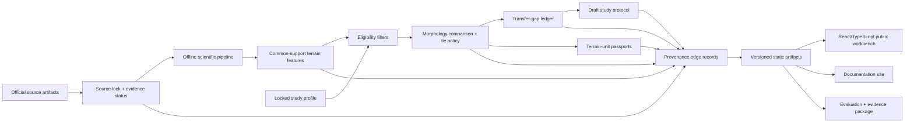

# Planetary Analog OS — TerraTrace v0.1
## Competition spine, evidence architecture, and international-scale roadmap

**Planning status:** Master plan, not an implementation claim  
**Working product name:** **TerraTrace** — Planetary Analog Terrain-Transfer Workbench  
**Long-term category:** **Planetary Analog OS**  
**Challenge:** NASA Space Apps 2026 — *Identify Earth Locations that Analog the Permanent Moon Base Locations and Mars*  
**Build calendar:** October 8–November 15, 2026, Asia/Kolkata

---

## 0. The critical correction: this must be a two-track plan

The current official 2026 Space Apps information says the event runs **November 14–15, 2026**. Project submission opens November 14 at 9:00 a.m. and closes November 15 at 11:59 p.m. local time. Official pre-event guidance allows participants to learn tools, explore data, and prepare, but says they may **not begin developing the solution they intend to submit before the hackathon starts**.

Therefore this is deliberately split into two tracks:

1. **October 8–November 13 — legal, competition-compliant readiness.** Research source products, practice generic geospatial skills, establish a clean-room execution system, and prepare verification checklists. Do **not** create challenge-project code, a challenge-project repository, derived challenge artifacts, a TerraTrace UI, rankings, or demo assets intended for submission.
2. **November 14–15 — build the actual submission from a clean repository after the official start.** The project is created, implemented, tested, documented, recorded, and submitted during the event.

This is not bureaucracy. It is a competitive advantage: the work arrives at kickoff with a tested decision process, but the solution itself is visibly created during the legal build window.

If written confirmation from the official organizer changes this interpretation, preserve that confirmation in `docs/event/eligibility-evidence.md` before changing this plan.

---

## 1. Executive decision

Build **TerraTrace v0.1**, the first auditable nucleus of Planetary Analog OS.

### One-sentence product definition

> TerraTrace is a provenance-first workbench that compares a curated Mars terrain unit with bounded Earth terrain units at a declared common map scale, shows which morphology observations transfer, exposes what does not, and outputs a draft research-study protocol instead of pretending an Earth site validates Mars operations.

### The exact first-release question

> Given one verified Mars terrain unit and a fixed, map-scale route-study scenario, which of two or three bounded Earth terrain units most closely matches the target’s declared slope, local-relief, ruggedness, and broad corridor-morphology distributions at common effective spatial support — or is the evidence insufficient to choose?

### The long-term category

**Planetary Analog OS** is a mission-to-field evidence system:

```text
Mission assumption
  → measurable requirement
  → planetary reference observation
  → Earth candidate terrain unit
  → explicit transfer-gap ledger
  → draft research-study protocol
  → observed field/simulation result
  → updated transfer evidence
```

The hackathon build proves only the first four links plus a protocol draft. It does not yet possess field outcomes, institutional partners, an analog-site network, or a predictive model.

### The strategic insight

The expensive failure in planetary analog work is not failing to find a landscape that visually resembles Mars. It is conducting an expensive Earth test whose result cannot legitimately transfer to the off-world decision it was supposed to inform.

TerraTrace is designed to make that failure visible before a field campaign begins.

---

## 2. The claim firewall — what v0.1 may and may not say

### Release claim

> “This prototype screens terrain morphology between curated map products at a declared common spatial support. It produces evidence-traceable, map-scale study designs. It does not estimate rover traversability, validate autonomy, establish geological equivalence, certify field access, or certify mission readiness.”

### Allowed claims

- It compares **declared map-scale terrain observables**.
- It preserves source, transformation, quality, resolution, and uncertainty information.
- It distinguishes morphology fit from non-transferable physics and field feasibility.
- It can return **tie**, **insufficient evidence**, or **not comparable** instead of forcing a winner.
- It creates a **draft research-study protocol** describing measurements needed before stronger claims are possible.
- It demonstrates a reusable provenance architecture for future analog research.

### Forbidden claims

- “This Earth location is Mars” or “this is a true Mars/Moon replica.”
- Rover safety, wheel-scale obstacle avoidance, traction, slip, sinkage, or mechanical regolith equivalence.
- Visual localization, SLAM, perception, navigation, or autonomy validation.
- Field permission, ecological approval, local-community consent, or operational feasibility.
- Mission readiness, landing-site suitability, communications-link performance, or NASA validation.
- A prediction of rover success, a commercial customer, NASA endorsement, or a completed field experiment.
- A generic single-number “Mars-likeness” score.

This claim firewall is a strength. It makes the project scientifically difficult to dismiss.

---

## 3. Product wedge: Mars-only morphology transfer, not Moon-plus-Mars

### Decision

Use **Mars only** in v0.1.

The broader NASA challenge supports Moon and Mars, but a combined first release would introduce two independent coordinate systems, terrain-product families, illumination regimes, surface physics narratives, and validation paths. It would reduce validity rather than increase ambition.

### Hero scenario

**Map-scale strategic route-study design for a hypothetical Mars rover mission.**

The scenario is deliberately not “can this rover drive there?” It is:

> “At the resolution of the selected Mars terrain product, where could a terrestrial study investigate planning behavior over comparable broad slope, relief, ruggedness, and corridor-connectivity structure?”

### Canonical output

The prepared experience contains:

- one Mars reference terrain unit;
- two minimum, three maximum Earth terrain units;
- one locked study profile;
- one transparent comparison;
- one morphology-fit matrix;
- one non-transferable-physics ledger;
- one field-feasibility ledger;
- one provenance trace;
- one draft study protocol;
- a valid **indeterminate** outcome if the data does not justify selection.

### Why this can become a major platform

A 39-day prototype cannot build a planetary operating system. It can establish its core primitive: a **mission-conditioned, evidence-traceable transfer record**.

If future experiments add actual outcomes, TerraTrace evolves from “a map comparison” into a compounding evidence network:

```text
Mission requirement + planetary evidence + Earth observation
+ study design + measured result + residual gap
= reusable transfer knowledge
```

That is the asset a generic GIS viewer does not automatically accumulate.

---

## 4. The scientific model

### 4.1 Evidence ladder

No source, site, or claim is accepted merely because a URL exists.

| Status | Meaning | Example |
|---|---|---|
| **U0 — Unverified lead** | A possible source or claim has been named but not inspected. | “MOLA may cover this region.” |
| **S1 — Source found** | A specific source artifact/product has been located. | Product page and candidate file located. |
| **M2 — Metadata verified** | Product identity, version, coverage, CRS, datum, terms, and quality metadata are checked. | PDS label and 3DEP metadata inspected. |
| **C3 — Claim-supported** | Exact evidence supports the displayed numeric or textual claim. | A shown slope statistic has source-to-feature lineage. |
| **R4 — Release-approved** | Transform, review, evidence, test, and release approval are complete. | The claim appears in the submitted demo/docs. |

The public app displays status and never upgrades an item automatically.

### 4.2 Minimum data contract

Each selected Mars or Earth terrain unit must carry:

```text
source_id
provider
product_id
product_version
source_url
retrieved_at
sha256
license_or_terms_url
redistribution_status
body
horizontal_crs
vertical_datum
units
acquisition_or_processing_date
effective_spatial_support_m
native_posting_m
coverage_geometry
nodata_policy
quality_mask_policy
analysis_extent_rule
resampling_or_aggregation_rule
transformation_id
uncertainty_or_limitations
claim_status
```

A named landscape is not an input. A **bounded terrain unit with a data contract** is an input.

### 4.3 Common-support rule

Resampling a high-resolution Earth DEM to a Mars raster posting does not make the observations scientifically equivalent. TerraTrace therefore applies this rule:

> Derive each cross-body feature only after both datasets are represented at the coarsest verified effective support and using the same declared physical analysis windows.

The app must show:

- native posting;
- verified effective support where known;
- common support selected for comparison;
- physical feature windows in metres;
- excluded scales;
- what cannot be observed at that support.

### 4.4 v0.1 feature contract

Use only three to five descriptors that can survive an adversarial scale review:

| Descriptor | Definition | What it may support | What it may not support |
|---|---|---|---|
| Directional slope distribution | Distribution of local slope/aspect at declared support | Broad morphology comparison | Wheel-scale slope or vehicle safety |
| Local relief | Elevation range or robust relief statistic over a declared metre-scale window | Broad terrain variation | Rock height or obstacle field |
| Detrended topographic ruggedness | Declared ruggedness statistic after removing broader trend | Relative morphology at declared support | Mechanical roughness or soil strength |
| Low-slope connectivity | Conditional connectivity of cells below a declared study threshold | A map-scale corridor study | Route feasibility or traversability |
| Data comparability | Coverage, nodata, effective support, uncertainty, metadata quality | Eligibility/uncertainty | Terrain similarity |

Every feature has a definition, unit, physical window, source, transform, and limitation.

### 4.5 Three outputs, never one magical score

TerraTrace has three non-compensatory result layers:

1. **Morphology fit** — feature-by-feature distance or distribution comparison at common support.
2. **Non-transferable physics** — gravity, atmosphere, regolith mechanics, dust electrostatics, radiation, thermal cycling, illumination, and communication conditions. These are explicitly unassessed or non-replicable; they are not hidden inside an adjustable score.
3. **Field feasibility** — data completeness, access/permission status, ecology/community status, safety status, and repeatability. Unknown is not green.

The decision engine uses eligibility filters first. Only then does it show a morphology comparison. A unit that fails data validity, sensitivity status, or critical metadata completeness cannot be “saved” by similarity.

### 4.6 Result states

The system can output only these states:

```text
RECOMMEND FOR MAP-SCALE FOLLOW-UP STUDY
TIE — INSUFFICIENT MORPHOLOGY DISCRIMINATION
NOT COMPARABLE AT AVAILABLE SUPPORT
BLOCKED — DATA/RIGHTS/CONSTRAINT STATUS INCOMPLETE
```

This is more credible than always selecting a winner.

---

## 5. The user experience and first-minute demo

### First 60 seconds

1. **0:00–0:10 — The hard truth**
   - “A terrain that looks like Mars may still produce a useless rover study.”
   - Show the scope ribbon: *map-scale morphology only; not rover validation.*

2. **0:10–0:25 — The study profile**
   - Mars reference terrain unit.
   - Defined physical windows.
   - Broad slope threshold and low-slope connectivity scenario.
   - Evidence status for each assumption.

3. **0:25–0:40 — Compare Earth units**
   - Two/three cards display morphology fit, data comparability, sensitivity, field-feasibility status, and transfer-gap badges.
   - A candidate that looks visually striking may lose because its data is non-comparable or key feasibility evidence is missing.

4. **0:40–0:52 — The scientific differentiator**
   - Open “What this comparison cannot establish.”
   - Show unassessed gravity, atmosphere, regolith mechanics, wheel-soil interaction, and operational access.

5. **0:52–1:00 — Actionable output**
   - Export a draft study protocol: required follow-up measurements, metadata, rejection criteria, ecological/community checks, and the claim it could support after validation.

### Product screens

| Screen | Decision it supports | Required visible evidence |
|---|---|---|
| Study profile | What is being compared? | Scope, physical windows, thresholds, claim status |
| Comparison workbench | Which unit is comparable? | Per-feature values, ranges, support, uncertainty, filters |
| Sensitivity view | Is the result stable? | Pairwise rank flips, scenarios, ties, no-data handling |
| Transfer-gap ledger | What cannot transfer? | Explicit physics/operations gaps and reason |
| Terrain-unit passport | What do we know about the Earth unit? | Data/terms/status/constraints/provenance |
| Draft study protocol | What should be measured next? | Hypothesis, data collection, acceptance/rejection, limitations |
| Evidence trace | Why should anyone trust this value? | Source → transform → feature → result chain |

### Accessibility non-negotiables

- Every map conclusion exists in an equivalent table.
- Keyboard operation completes the prepared flow.
- No color-only status encoding.
- Patterns, text, icons, and explicit uncertainty labels accompany colors.
- Charts offer text summaries and downloadable CSV/JSON.
- Reduced-motion preference is respected.
- The prepared comparison works at 200% zoom and narrow mobile width.
- No WebGL is required.

---

## 6. Technical architecture: ambitious science, minimal operating surface



### v0.1 stack

| Layer | Decision | Reason |
|---|---|---|
| Scientific processing | Python, Rasterio/GDAL, PyProj, NumPy, optional SciPy | Mature raster, projection, and numerical work |
| Data validation | Pydantic or JSON Schema; YAML/JSON manifests | Make missing metadata a visible failure |
| Analysis artifacts | Parquet/GeoParquet internally; small JSON/CSV/browser bundles publicly | Reproducible analytics without shipping raw rasters |
| Web app | React + TypeScript + Vite | Static deployment, testable components, zero backend requirement |
| Visuals | Accessible SVG/canvas charts; static map raster + verified overlays | Avoid unverified planetary web-map projections |
| Testing | Pytest, Vitest, Playwright, axe-core | Scientific, schema, UI, and accessibility checks |
| Docs | MkDocs Material or Docusaurus | Searchable public documentation book |
| CI | GitHub Actions | Build, test, link-check, docs, artifact-manifest verification |
| Hosting | Static site host + immutable release assets | No secrets or runtime API failure in demo |

### Explicitly excluded from v0.1

- No microservices.
- No graph database.
- No live API dependency.
- No user accounts.
- No proprietary machine-learning ranker.
- No LLM chat interface.
- No 3D globe for spectacle.
- No blockchain.
- No actual site marketplace.
- No raw sensitive-location publication.

### Artifact contract

```text
artifacts/
  source-lock.json
  study-profile.json
  terrain-units.geojson
  feature-definitions.json
  feature-measurements.parquet
  comparison-runs.json
  sensitivity-runs.json
  transfer-gap-ledger.json
  passports/
  draft-protocols/
  evidence-edges.json
  evaluation-summary.json
  release-manifest.json
```

Every artifact includes an immutable ID, configuration ID, generator version, input hashes, and evidence status.

### Clean repository after kickoff

```text
terratrace/
  README.md
  LICENSE
  CITATION.cff
  sources.lock.yml
  method.yml
  pyproject.toml
  package.json
  pipeline/
  web/
  schemas/
  artifacts/
  tests/
    scientific/
    fixtures/
    integration/
    e2e/
  docs/
  scripts/
  .github/workflows/
```

Use Apache-2.0 for original code unless a different OSI-compatible license is deliberately selected. Cite every source and keep source-specific redistribution rules separate from original project code.

---

## 7. Verification and ablation plan

### What each evidence method can prove

| Method | What it proves | What it does not prove |
|---|---|---|
| Synthetic terrain fixtures | Calculation and decision-logic correctness | Mars-to-Earth operational transfer |
| Independent GIS re-derivation | Pipeline consistency | Rover performance |
| Source metadata review | Correct product interpretation | Data suitability by itself |
| Resolution/sensitivity analysis | Assumption dependence and rank stability | Physical equivalence |
| Reviewer feedback | Construct validity and claim boundary quality | NASA validation |
| User walk-through | Comprehension and misuse resistance | Scientific performance |
| Future field outcomes | Potentially tests limited transfer claims | Universal analog validity |

### Required fixtures

- Flat plane, known slope, and directional aspect.
- Synthetic ridge and crater-rim surfaces.
- Equal morphology at different native resolutions.
- Different morphology after common-support aggregation.
- Missing-data wedge.
- One data-complete but poor-fit candidate.
- One visually attractive but data-incomplete candidate.
- One eligibility-blocked candidate.
- One stable tie.

### Required ablations

| Full method | Degraded method | Metric / decision behavior |
|---|---|---|
| Task-conditioned morphology profile | Equal-weight generic similarity | Pairwise flip matrix and study-choice rationale |
| Common effective support | Native-resolution comparison | Feature shift and rank/eligibility changes |
| Visible uncertainty and sensitivity | Point estimate only | Overconfidence/misinterpretation rate |
| Explicit transfer-gap ledger | Morphology-only result | User ability to identify unassessed physics |
| Eligibility filters | Soft score penalty | Invalid/unknown unit selection rate |
| Provenance drawer | Hidden sources/transforms | Time to trace a value to its evidence |
| Missingness propagation | Zero-fill or silent interpolation | False-certainty rate |

Do not claim the “full method outperforms” anything without a predeclared benchmark. The hackathon evidence should demonstrate **logic correctness, transparency, sensitivity, and user comprehension**.

### Release targets

- 100% of visible numeric values trace to source, transform, and unit.
- Two independent clean runs reproduce the canonical artifact hashes, where source terms allow raw assets to be retained.
- Every fixture has an expected outcome and a passing test.
- No display uses a value below its supported scale.
- The app can return tie/indeterminate.
- At least four of five participants identify one measured comparison and two unassessed transfer gaps; if only three participants are available, report raw counts without false statistical language.
- No participant believes the output certifies a rover for Mars.
- The canonical flow works offline after assets are loaded.

---

## 8. Gates and kill criteria

### Compliance and scientific gates

| Gate | Deadline | Pass condition | Failure action |
|---|---|---|---|
| **P0 — Rules lock** | Oct 8–9 | Event status, terms, no-prebuild rule, license/citation requirements archived | Treat plan as public continuation only; obtain organizer clarification |
| **P1 — Source reconnaissance** | Oct 10–12 | At least one plausible Mars product and two Earth-product paths have inspectable metadata, rights, coverage, and support documentation | Do not name an actual challenge project candidate yet; retain alternatives |
| **P2 — Generic capability proof** | Oct 13–17 | Separate throwaway/synthetic practice establishes that common-support feature workflow is technically understood | If unsuccessful, narrow event scope to a visual evidence audit instead of ranking |
| **P3 — Clean-room readiness** | Nov 13 | Empty event repository plan, environment checks, build list, review checklist, submission checklist; no solution code/assets | Stop any project-specific prebuild work |
| **G0 — Event kickoff contract** | Nov 14, 09:00 local | New repository created after kickoff; scope, claims, and data contract locked | Cut extra body/sites/features |
| **G1 — Actual data contract** | Nov 14, 11:30 | One Mars unit + two Earth units have exact product identity, bounds, metadata, terms, and common-support path | Pivot to evidence audit; do not rank |
| **G2 — Observability decision** | Nov 14, 14:30 | Three-to-five features are resolvable at declared support; no unsupported detail enters scoring | Reduce to fewer features or return not comparable |
| **G3 — Offline vertical slice** | Nov 14, 22:30 | Profile → compare → gap ledger → provenance → draft protocol works from local static artifacts | Freeze all non-core product work |
| **G4 — Scoring audit** | Nov 15, 10:30 | Fixtures, missingness, sensitivity, tie policy, and independent reread are complete | Downgrade output to exploratory comparison; remove recommendation language |
| **G5 — Claim/usability audit** | Nov 15, 15:00 | Every public claim has C3/R4 evidence; independent walk-through catches no critical misconception | Delete unsupported claims and simplify flow |
| **G6 — Reproducibility/documentation lock** | Nov 15, 18:00 | Test suite, manifests, README, docs, and offline runtime evidence match UI | State only what actually rebuilt and worked |
| **G7 — Submission lock** | Nov 15, 22:30 | Video, submission text, source link, demo, docs, sources, and licenses are mutually consistent | No new features; repair only release blockers |

### Kill criteria

Kill or sharply pivot the ranking product if any is true:

1. No lawful, documented path exists for one Mars unit and two Earth units at G1.
2. Feature values are dominated by unresolvable support/resolution differences.
3. A score cannot be traced to source, transform, unit, and limitation.
4. The only compelling claim is “this Earth terrain looks like Mars.”
5. The product cannot return tie, not-comparable, or blocked.
6. The core demo requires a live external service.
7. Users read the output as rover safety or operational certification.
8. Site/community/ecological status is represented as known when it is actually unknown.
9. Scientific validation is being removed to preserve visual polish.

### The correct pivot

If comparison fails, ship **Planetary Analog Transfer Audit**:

> A provenance-first tool that demonstrates why a proposed Earth–Mars analog comparison is invalid or indeterminate at the available spatial support.

A rigorous refusal is internationally stronger than a misleading recommender.

---

## 9. Competition-compliant work plan, October 8–November 15

### Capacity model

| Plan | Readiness before Nov 14 | Event implementation Nov 14–15 | Total | Purpose |
|---|---:|---:|---:|---|
| **Ceiling** | 215 h | 25 h | 240 h | Maximum lawful preparation plus a demanding event sprint |
| **Governing plan** | 185 h | 25 h | **210 h** | Recommended full-duration plan |
| **Emergency cutline** | 135 h | 15 h | 150 h | Protects integrity, sources, provenance, and core demo |

The governing plan contains 185 hours of readiness and 25 hours of actual event build. Preparation must remain non-solution-specific. Every week includes a recovery day; meals, movement, and at least seven hours of sleep during the event are mandatory constraints, not optional polish.

### Phase A — readiness only, no submitted-project development

| Dates | Hrs | Legal objective | Concrete non-solution deliverables | Acceptance gate |
|---|---:|---|---|---|
| Oct 8–11 | 18 | Rules, terms, team, and evidence discipline | Event facts packet; citation/license checklist; clean-room rules; claim-firewall card; one-page risk ledger | P0 complete; no project repository or project artifacts exist |
| Oct 12–18 | 34 | Data literacy and generic geospatial competency | Product-label reading notes; generic synthetic DEM practice; generic CRS/common-support exercises; resolution-error log | P1/P2 ready; no Mars/Earth comparison result retained for submission |
| Oct 19–25 | 34 | Scientific-method rehearsal | Generic fixture catalog; generic provenance schema exercise; independent GIS reproducibility drill; reviewer question bank | Method can explain scale, datum, missingness, and uncertainty |
| Oct 26–Nov 1 | 34 | Product and presentation readiness | Empty-page information architecture; accessibility checklist; demo storytelling drill using unrelated toy data; UI test criteria | Every user-facing claim has a place in claim firewall |
| Nov 2–8 | 34 | Release and evaluation readiness | Clean-room event runbook; CI/tool installation verification; generic test runner drill; docs structure template; screen-recording rehearsal | A new blank repo can be bootstrapped quickly without copied solution code |
| Nov 9–13 | 31 | Freeze and protect eligibility | Event-hour checklist; source-inspection sequence; stop/pivot decision tree; sleep/meal plan; submission metadata worksheet | P3 complete; no challenge solution code, data derivatives, rankings, or demo assets exist |

### Phase B — actual project build after official kickoff

#### Saturday, November 14 — 12 focused hours

| Local time | Work | Acceptance criterion |
|---|---|---|
| 09:00–09:30 | Create clean repository; commit event-start note; lock v0.1 claim firewall | Git history clearly begins after official kickoff |
| 09:30–11:30 | Inspect exact PDS/USGS source artifacts; choose one Mars and two Earth bounded units; construct source lock | G1 data contract has no U0 critical source |
| 11:30–13:00 | Define equal extents, common effective support, nodata policy, feature windows | Every analysis parameter is in `method.yml` |
| 14:00–16:00 | Implement pipeline for slope, relief, ruggedness, and low-slope connectivity; fixtures first | Synthetic fixtures pass before real-data metrics appear |
| 16:00–18:00 | Generate static artifacts, passport skeletons, evidence edge records | Artifact schema validates; every output has inputs/hashes |
| 18:30–21:00 | Build app flow: scope ribbon → profile → comparison → transfer gaps → provenance | Prepared path works without network |
| 21:00–22:30 | Build draft study protocol export; insert blocked/tie states | G3 vertical slice complete |
| 22:30–23:30 | Commit, deploy preview, record defects, stop and rest | No new features after vertical-slice failure is resolved |

#### Sunday, November 15 — 13 focused hours

| Local time | Work | Acceptance criterion |
|---|---|---|
| 08:30–10:30 | Sensitivity runs: common support, thresholds, missingness, rank/tie policy | G4 audit artifacts generated |
| 10:30–12:00 | Independent re-derivation/read-through; remove unsupported claims | Every visible number has C3 evidence or is hidden |
| 12:45–14:15 | Keyboard/mobile/contrast/offline checks; one independent user walkthrough if available | No critical misconception or access blocker remains |
| 14:15–16:00 | Documentation site, README, method, limitations, ablations, citation list | G5 claim/usability audit passed |
| 16:30–18:00 | Run clean build/test/deploy; generate manifest/checksums | G6 reproducibility evidence is truthful and complete |
| 18:00–19:30 | Capture screenshots; record 2–3 minute demo; write submission narrative | Demo shows evidence, not promises |
| 19:30–21:00 | Submit early; verify public links and metadata; preserve confirmation | Submission is not left until the final hour |
| 21:00–22:30 | Adversarial final check: sources, terms, claim firewall, packaging, video | G7 release lock |
| 22:30–23:30 | Only release-blocker repairs; final smoke test and commit/tag | Stable submitted package and evidence bundle |

### Emergency cutline: 150 hours

Keep:

- one Mars terrain unit;
- exactly two Earth units;
- three morphology descriptors;
- eligibility filters;
- common-support rule;
- explicit transfer-gap ledger;
- one terrain-unit passport;
- one draft protocol;
- synthetic fixtures;
- source lock/provenance;
- offline static demo;
- README/docs/video.

Cut first:

- third candidate;
- dynamic route visualization;
- interactive maps beyond a static contextual panel;
- optional imagery;
- public live search;
- additional scenario controls;
- animation;
- translations;
- ML;
- any feature not needed for evidence traceability.

Never cut: source locks, limitations, tie/not-comparable behavior, fixtures, common-support check, provenance, docs, or the video’s honest boundary.

---

## 10. The launch package

### Repository-level deliverables

- Static deployed TerraTrace workbench.
- Full source repository under an OSI-compatible license.
- `sources.lock.yml` with terms and product-level citations.
- `method.yml` defining analysis windows and decisions.
- Artifact schemas and source-to-score provenance edges.
- Fixtures, test suite, and CI logs.
- A static offline package.
- `CITATION.cff` and structured bibliography.
- Release manifest with checksums.

### Public credibility surfaces

1. **README top viewport**
   - One-sentence pitch.
   - Scope ribbon: map-scale morphology; not rover validation.
   - “Open prepared comparison” link.
   - Screenshot/short loop.
   - Docs, source, evidence, and video links.
   - Limitations link immediately visible.

2. **Documentation site**
   - Why analog claims fail.
   - Hero study profile.
   - Data contracts and source locks.
   - Common-support methodology.
   - Feature definitions.
   - Morphology comparison and tie policy.
   - Transfer-gap ledger.
   - Passports and draft protocols.
   - Fixtures, ablations, sensitivity.
   - Accessibility, ethics, and data governance.
   - Reproducibility and limitations.

3. **Evaluation page**
   - Not “we achieved 99%.”
   - Show what software fixtures validate, what sensitivity shows, and what remains unvalidated.

4. **Demo video**
   - 2–3 minutes.
   - Shows one compelling decision and the refusal mechanism.

### Two-minute demo script

| Time | Narrative | Evidence shown |
|---|---|---|
| 0:00–0:15 | “Finding a landscape that looks like Mars is easy. Designing a test whose result transfers to Mars is hard.” | Scope ribbon and Mars unit |
| 0:15–0:35 | “TerraTrace begins with a declared map-scale study profile, not a generic similarity score.” | Physical windows, source/status labels |
| 0:35–0:55 | “At common effective support, these terrain units differ by slope, local relief, ruggedness, and broad corridor connectivity.” | Feature matrix with units and source links |
| 0:55–1:15 | “This candidate does not win merely because it looks good. The system filters incomplete data and exposes sensitivity.” | Eligibility state + scenario/tie behavior |
| 1:15–1:35 | “Even the closest morphology match cannot reproduce gravity, atmosphere, regolith mechanics, dust, radiation, or permission status.” | Transfer-gap ledger |
| 1:35–1:55 | “Instead of declaring mission readiness, TerraTrace exports a draft study protocol describing what must be measured next.” | Passport/protocol |
| 1:55–2:20 | “Every value traces to a source, transform, test, and limitation. When evidence is weak, TerraTrace says so.” | Evidence trace + fixture/sensitivity report |

---

## 11. International, ethical, and governance posture

A terrestrial analog site is never an empty coordinate.

### v0.1 requirements

- A passport has separate status fields for **data availability**, **publication permission**, **field access**, **ecological constraint**, **community/Indigenous governance**, and **safety**.
- Unknown permission/access is a blocking or indeterminate state, not a positive signal.
- No exact sensitive coordinates are published without authorization.
- Public remote-sensing data does not imply permission to visit or test.
- The draft protocol contains a stop condition for permit, community, ecological, or safety failure.
- The app labels local/community information as source-status-dependent, never inferred from imagery.

### International growth principle

The long-term platform must make local institutions and site custodians contributors and beneficiaries, not data suppliers for an external mission program. It needs configurable regional governance, multilingual evidence fields, country-specific access rules, provenance-preserving data sovereignty, and benefit-sharing agreements before it becomes a site network.

---

## 12. Value architecture — ambition without fake valuation claims

### The honest value ladder

| Stage | What exists | What it proves | What it does not prove |
|---|---|---|---|
| Hackathon release | Evidence-traceable morphology workbench | A new decision/communication primitive | Product-market fit, rover performance, recurring revenue |
| 90-day research kernel | Multiple curated cases, expert review, first permitted study | Repeatability and research usefulness | Institutional purchasing demand |
| 1-year institutional pilot | Private workspace, study reports, field-result ingestion | A buyer may value workflow/provenance | A scalable platform or global standards role |
| 3-year evidence network | Validated protocols, outcome data, governed site partners | Compounding transfer evidence | Global monopoly or universal analog standard |
| 5–10-year infrastructure | Interoperable ontology, benchmarks, multi-agency use | Potential strategic data-layer role | Guaranteed billion/trillion valuation |

### Million-scale potential

A credible path to millions in annual revenue requires evidence that institutions pay to reduce failed/duplicative test planning, generate reviewable study packages, govern access to sensitive sites, and preserve mission-to-experiment provenance. This needs pilots and outcome data, not a hackathon pitch.

### Billion-scale potential

A billion-scale company outcome is conceivable only if TerraTrace becomes an institutional workflow and evidence platform across planetary robotics, remote operations, extreme-environment autonomy, and field-study governance. It would require trusted integrations, recurring enterprise usage, network effects, validated outcome data, and a difficult-to-copy standards position.

### Trillion-scale language

Do **not** claim that the company will be worth trillions. That is not evidence-based.

The only intellectually defensible “trillion-scale” framing is long-term **economic throughput influenced**: a widely adopted evidence standard could reduce risk across large future planetary and terrestrial infrastructure programs. That is a remote conditional possibility, not a valuation forecast, and should not be used in the hackathon pitch.

### The real moat sequence

1. Open, transparent ontology and provenance contract.
2. Curated, reproducible benchmark cases.
3. Field/simulation outcome records tied to pre-test expectations.
4. Calibrated transfer-gap evidence.
5. Trusted local/site-operator governance relationships.
6. Institutional workflow embedding and interoperability standards.

The interface is easy to copy. The validated evidence history and governance network are not.

---

## 13. Post-event roadmap

### Days 1–90 after the event

- Publish postmortem with all claims checked against evidence.
- Add five curated terrain-transfer cases only after product-level source verification.
- Conduct structured interviews with planetary robotics labs, geospatial researchers, analog-program operators, and local site stewards.
- Seek one permitted, low-impact study or simulation comparison; do not conduct physical work without formal authorization.
- Establish an external scientific/advisory review process.
- Measure whether people use the tool to make better-scoped study claims.

### Year 1

- Expand from morphology screening into controlled study-design templates.
- Support additional task families only where data and validation justify them.
- Ingest field and simulation results with pre-registered protocols.
- Build a governed schema for access, community constraints, environmental conditions, and sensitive location handling.
- Publish a methods paper only if the evidence supports it.
- Test institutional pilot demand before building enterprise infrastructure.

### Years 2–3

- Create a benchmark suite of task-conditioned analog studies.
- Integrate with rover simulators, laboratory test rigs, and field-data systems.
- Establish a vetted partner network of institutions and site operators.
- Add multi-agency data paths only when source/rights/provenance contracts are strong.
- Build private workspaces, audit trails, controlled data access, and institutional review workflows.

### Years 5–10

The end-state is an interoperable evidence layer for planetary operations: mission assumptions, terrain observations, field/simulation tests, uncertainty, and transfer evidence become comparable across organizations. Success requires scientific credibility, governance legitimacy, open standards, and demonstrated outcomes—not a map catalog.

---

## 14. The one action today

Create the **P0 Event and Eligibility Evidence Packet**.

It must contain:

```text
- official 2026 event page screenshot/PDF
- project submission opening and closing time
- participant terms and source/license requirements
- official pre-event no-development guidance
- official judging criteria
- exact selected challenge page or official event-team page description
- date/time of capture
- one sentence: “No submitted-project code or artifacts before official kickoff.”
```

### Pass criterion

You can point to primary official language for every claim about event timing, submission, pre-event work, judging, citations, and open-source obligations.

### Fail criterion

Any competition rule in the plan rests only on a search snippet, memory, a local-event summary, a social post, or an assumption. If that occurs, do not begin challenge-specific work; get written organizer clarification.

---

## 15. Source entry points and verification status

These are authoritative entry points identified during planning. The project must still inspect exact source artifacts, labels, terms, and checksums during G1.

### Space Apps

- [NASA Space Apps Challenge 2026 event page](https://www.spaceappschallenge.org/2026/) — official event dates and submission window.
- [2026 Participant Terms and Conditions](https://www.spaceappschallenge.org/legal/) — eligibility, source citation, and open-source/original-content obligations.
- [2026 local-event pre-event guidance](https://www.spaceappschallenge.org/2026/local-events/santiago-dominican-republic/) — official statement that preparation is permitted but submitted-solution development may not begin before the hackathon.
- [2026 Ajmer local event](https://www.spaceappschallenge.org/2026/local-events/ajmer/) — judges projects on Impact, Creativity, Validity, Relevance, and Presentation.
- [Official challenge description mirrored in a 2026 team page](https://www.spaceappschallenge.org/2026/find-a-team/lunar-terra/) — challenge focus on using open Earth, Moon, and Mars data to characterize terrestrial analogs.

### Planetary sources

- [PDS LRO LOLA archive](https://pds-geosciences.wustl.edu/missions/lro/lola.htm) — lunar topography; retained only as a future/reference source in Mars-only v0.1.
- [PDS MGS MOLA archive](https://pds-geosciences.wustl.edu/missions/mgs/mola.html) — Mars altimetry/topography source family.
- [PDS MOLA MEGDR archive](https://pds-geosciences.wustl.edu/missions/mgs/megdr.html) — Mars global gridded topography products.

### Earth terrain and standards

- [USGS 3D Elevation Program](https://www.usgs.gov/3d-elevation-program) — public U.S. terrain data program.
- [USGS National Map downloads](https://www.usgs.gov/the-national-map-data-delivery/gis-data-download) — terrain product discovery/download path.
- [USGS 3DEP 1/3-arc-second dataset record](https://data.usgs.gov/datacatalog/data/USGS%3A3a81321b-c153-416f-98b7-cc8e5f0e17c3) — approximately 10 m bare-earth DEM collection details; verify exact local coverage/product before use.
- [NASA Earthdata Search](https://search.earthdata.nasa.gov/) — Earth-science source discovery.
- [STAC specification](https://stacspec.org/en/) — provenance/catalog interoperability reference.

---

## Final standard

> TerraTrace does not show where Earth resembles Mars. It creates a reproducible, evidence-bounded answer to a harder question: which terrestrial study can support a specific map-scale Mars terrain hypothesis, what cannot transfer, and what evidence must exist before the next claim is allowed.
