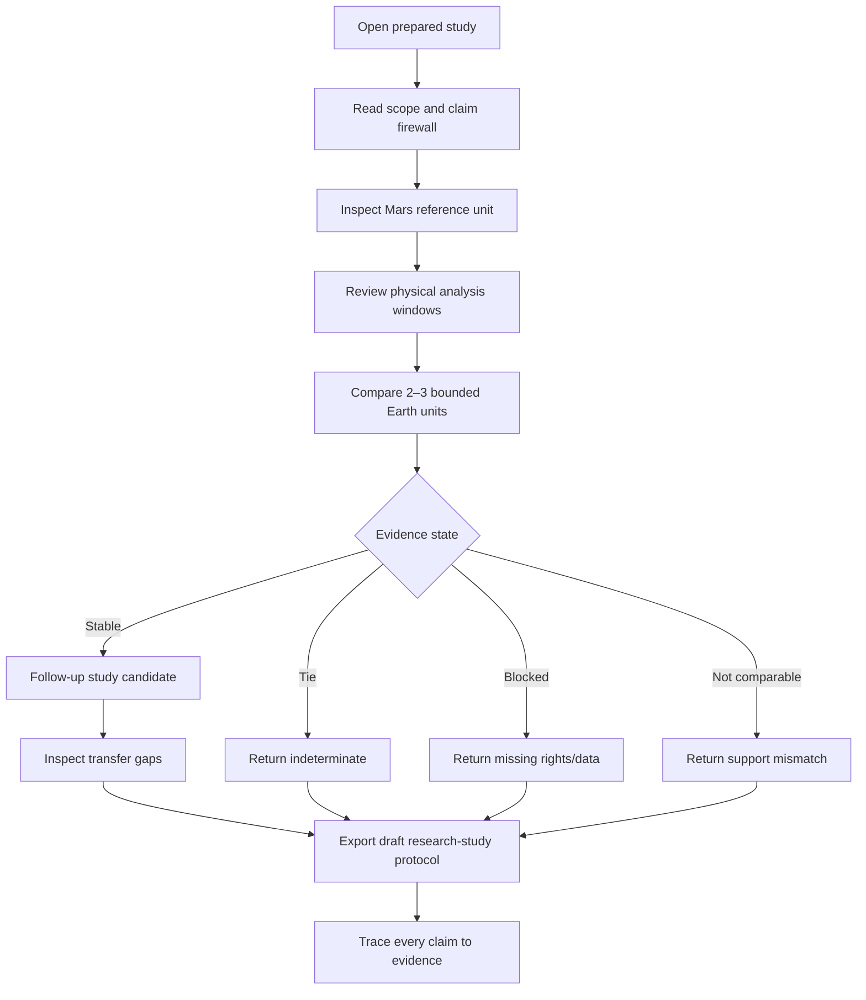

# 01 — Product and Mission Model

## Product naming

**Category:** Planetary Analog OS  
**First product:** TerraTrace  
**Release descriptor:** Planetary Analog Terrain-Transfer Workbench v0.1

## The unit of value

The unit is a **mission-conditioned study record**, not a map tile and not a site score:

```json
{
  "mission_task": "map_scale_terrain_route_study",
  "planetary_reference": "mars:verified_terrain_unit:v1",
  "earth_terrain_units": ["earth:A", "earth:B"],
  "requirements": ["slope_distribution", "local_relief", "ruggedness", "low_slope_connectivity"],
  "common_effective_support_m": 100,
  "morphology_result": "tie_or_follow_up",
  "transfer_gaps": ["gravity", "regolith_mechanics", "atmosphere", "radiation"],
  "field_feasibility": "unknown_until_permitted",
  "draft_protocol_id": "protocol:...",
  "evidence_status": "R4"
}
```

## Primary user and job

**Primary user:** planetary robotics researcher, analog-program planner, university rover team, or mission-concept engineer.

**Job:** “I need a defensible study design that says which terrain comparison is worth investigating, what I can measure, what it cannot establish, and how to preserve the evidence.”

## v0.1 user journey



## Mission profile schema

A mission profile is not a prose prompt. It is a typed contract.

| Field | Type | Required | Example |
|---|---|---:|---|
| `task_id` | enum | yes | `map_scale_terrain_route_study` |
| `target_body` | enum | yes | `mars` |
| `reference_unit_id` | ID | yes | `mars_unit_01` |
| `analysis_support_m` | positive number | yes | `100` |
| `slope_window` | interval | yes | `[0, 100]` percent |
| `relief_window_m` | positive number | yes | `500` |
| `ruggedness_window_m` | positive number | yes | `500` |
| `connectivity_threshold` | number | yes | `15` degrees |
| `quality_policy` | enum | yes | `reject_unknown` |
| `access_policy` | enum | yes | `show_unknown_not_approved` |
| `claim_maturity` | enum | yes | `prototype_morphology_only` |

Every requirement stores:

```text
requirement_id
semantic_definition
value
unit
physical_window_m
source_or_assumption
uncertainty
hard_or_soft
transferability_class
claim_status
```

## Product behavior

### Profile compiler

The compiler maps a task template to observable requirements. It must expose the mapping rather than hide it.

```text
Task: map-scale terrain route study
  → slope distribution
  → local relief
  → detrended ruggedness
  → low-slope connectivity
  → data support/comparability
  → rights/access/field feasibility metadata
```

### Comparison workbench

The workbench shows per-feature distribution comparisons. It does not display a single “Mars-likeness” number.

### Transfer-gap ledger

Each gap has:

- category;
- reason it is non-replicable or unassessed;
- whether it affects the specific study claim;
- evidence source;
- what future experiment or data is required;
- prohibited interpretation.

### Draft study protocol

The protocol is explicitly a draft. It contains:

- study objective;
- pre-test hypothesis;
- source and analysis configuration;
- terrain unit geometry;
- physical measurement windows;
- field/simulation measurements required;
- acceptance/rejection criteria;
- missing-data and uncertainty conditions;
- access/ethics/safety checks;
- interpretation boundary;
- post-study evidence update fields.

## Long-term module expansion

| Version | Added capability | Required evidence first |
|---|---|---|
| v0.1 | Mars morphology audit | Source and scale contract |
| v0.2 | Additional task profiles | Expert review and fixtures per task |
| v0.3 | Controlled field/simulation outcomes | Pre-registered protocols and result capture |
| v1.0 | Institutional workspaces | Security, audit, governance, repeat customers |
| v2.0 | Cross-agency evidence network | Interoperability and data-rights contracts |
| v3.0 | Calibrated transfer recommendations | Sufficient outcome corpus and held-out validation |

## Non-goals

- Mission certification.
- Rover operation.
- Site permission granting.
- Universal analog scoring.
- Automated scientific publication.
- Replacing a planetary scientist, field lead, local authority, or safety officer.
