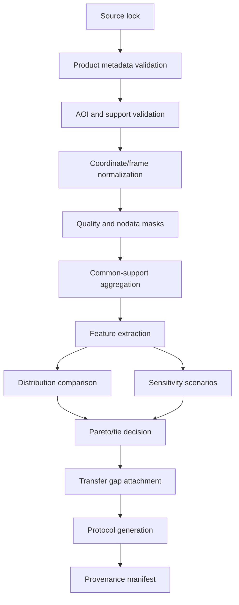

# 04 — Algorithms and Equations

## Algorithm boundaries

The algorithm is a transparent evidence transformation. It is not a hidden AI decision-maker and does not predict rover behavior.

## Pipeline



## Coordinate normalization

For Earth data, use a projected CRS appropriate to the bounded AOI for metre-scale windows. For planetary data, use the product-defined planetary CRS and explicit body-specific coordinate rules. Do not force all data into Web Mercator.

The transform contract stores:

```text
source_crs
source_axis_order
source_units
source_vertical_datum
target_crs
target_units
axis_order_policy
longitude_convention
latitude_type
transform_library_and_version
transform_parameters
```

Round-trip tests must demonstrate that representative coordinates return within a declared tolerance.

## Common-support aggregation

Given source grid \(G_s\), target analysis support \(w\), and quality mask \(Q\):

\[
Z^*_{w}(u) = A_w\left(\{z(v):v\in G_s\cap W_w(u), Q(v)=1\}\right)
\]

where \(A_w\) is a declared aggregation operator, such as robust mean, median, quantile, or area-weighted aggregation. Record the number and fraction of valid contributing cells.

If support cannot be estimated or coverage is insufficient, return `NOT_COMPARABLE` rather than inventing \(Z^*\).

## Feature extraction

### Slope

\[
\theta = \arctan\left(\sqrt{z_x^2 + z_y^2}\right)
\]

Require a unit-consistent x/y grid. Report degrees and optionally percent grade:

\[
\text{grade} = 100\tan(\theta)
\]

### Robust relief

\[
R_w = Q_{1-\alpha}(Z|W_w)-Q_{\alpha}(Z|W_w)
\]

with \(\alpha\) predeclared, e.g. 0.05. The chosen quantile is a method parameter, not a tuning knob chosen after seeing rankings.

### Detrended ruggedness

\[
T_w = \sqrt{\frac{1}{n_w}\sum_{j=1}^{n_w}(z_j-\hat z_j)^2}
\]

where \(\hat z_j\) is a fitted local trend. Report fit model, degree, window, and valid-count fraction.

### Low-slope connectivity

For binary valid set \(V\):

\[
V(u)=\mathbf{1}[\theta(u)\leq\theta_{max}]\mathbf{1}[Q(u)=1]
\]

Compute connected components under 4- or 8-neighborhood or a metric-aware adjacency. Report selected policy and sensitivity.

## Distribution distance

For scalar feature distributions \(X\), \(Y\):

### Wasserstein-1

\[
W_1(X,Y)=\int_0^1|F_X^{-1}(q)-F_Y^{-1}(q)|\,dq
\]

### Kolmogorov–Smirnov

\[
D_{KS}(X,Y)=\sup_x|F_X(x)-F_Y(x)|
\]

### Quantile fingerprint

Use a vector:

\[
\mathbf{q}(X) = [Q_{0.05},Q_{0.25},Q_{0.50},Q_{0.75},Q_{0.95}]
\]

Report both the vector difference and a normalized summary; never hide the fingerprint behind one scalar.

## Pareto decision

For metrics where lower distance is better, Earth unit \(a\) dominates \(b\) when:

\[
\forall r,\ d_r(a)\le d_r(b) \quad\land\quad \exists r,\ d_r(a)<d_r(b)
\]

If multiple units are non-dominated, output `TIE` or `FOLLOW_UP_STUDY_SET`. A recommendation is allowed only when:

- the unit is eligible;
- the unit remains non-dominated across declared sensitivity scenarios;
- no critical transfer/rights/quality blocker exists;
- the narrative states exactly what the recommendation means.

## Sensitivity scenarios

Predeclare scenarios \(\Omega\):

```text
native_valid_support
common_conservative_support
alternate_resampling
alternate_validity_threshold
alternate_missingness_policy
alternate_analysis_window
reference_unit_boundary_shift
```

For each unit and metric, calculate:

\[
\Delta_r(i,\omega)=d_r(i,\omega)-d_r(i,\omega_0)
\]

and rank-flip matrix:

\[
F_{ij}=\frac{1}{|\Omega|}\sum_{\omega\in\Omega}
\mathbf{1}[\operatorname{sign}(d_i-d_j)_\omega\neq
\operatorname{sign}(d_i-d_j)_{\omega_0}]
\]

A high \(F_{ij}\) means the pairwise decision is assumption-sensitive. A stable tie is more honest than a forced winner.

## Missingness propagation

For each feature, record valid fraction:

\[
v_r = \frac{n_{valid,r}}{n_{candidate,r}}
\]

A feature fails eligibility when \(v_r < \tau_r\), where \(\tau_r\) is declared before analysis. Do not replace missing values with a global mean without emitting an explicit imputation status and uncertainty.

## Study-protocol generation algorithm

```text
inputs:
  selected terrain unit(s)
  requirement profile
  evidence status
  feature/sensitivity results
  transfer-gap ledger
  rights/ethics/safety metadata

if any critical source is U0/S1:
  protocol_status = draft_only
if critical comparability fails:
  outcome = not_comparable
  protocol = data-collection-and-validation protocol
else if ranking flips exceed threshold:
  outcome = indeterminate
  protocol = sensitivity-resolution study
else:
  outcome = follow_up_study_candidate
  protocol = morphology follow-up study with explicit nonclaims

emit:
  hypothesis
  measurement list
  instruments/data products required
  AOI and windows
  quality criteria
  stop conditions
  acceptance/rejection rules
  ecological/community/access checks
  expected transfer boundary
  result-update schema
```

## Complexity and performance

Let \(N\) be valid raster cells, \(k\) number of windows, \(m\) number of scenario configurations, and \(s\) number of Earth units:

- preprocessing/aggregation: approximately \(O(N)\) per configuration;
- local windows: \(O(kN)\) naïvely, reducible with integral/optimized raster operations;
- distribution comparison: \(O(n\log n)\) for sorted samples or approximate sketches;
- sensitivity: approximately \(O(m\cdot s\cdot C_{features})\).

The v0.1 pipeline is offline. Optimize only after measuring. The primary risk is not web latency; it is scientific correctness and source/support interpretation.

## Determinism

- Sort all input file lists and entity IDs.
- Pin library/environment versions.
- Define random seeds for sampling.
- Record hash of configuration and inputs.
- Use stable floating-point tolerances.
- Store software commit and generator version.

## Algorithm test matrix

| Test | Fixture | Expected |
|---|---|---|
| Flat plane slope | z=ax+by | Constant known slope |
| Ridge visibility | synthetic ridge | Relief changes only at declared windows |
| Translation | shifted surface | Distance behavior documented |
| Scale | same surface aggregated | Sensitivity exposed, not hidden |
| Missing wedge | nodata region | Valid fraction/blocked result |
| Equal units | identical arrays | Distance zero within tolerance |
| Pareto | known vectors | Dominance and tie correct |
| Rank flip | scenario variants | Flip matrix matches manual result |
| Determinism | repeated run | Same artifact hash |
