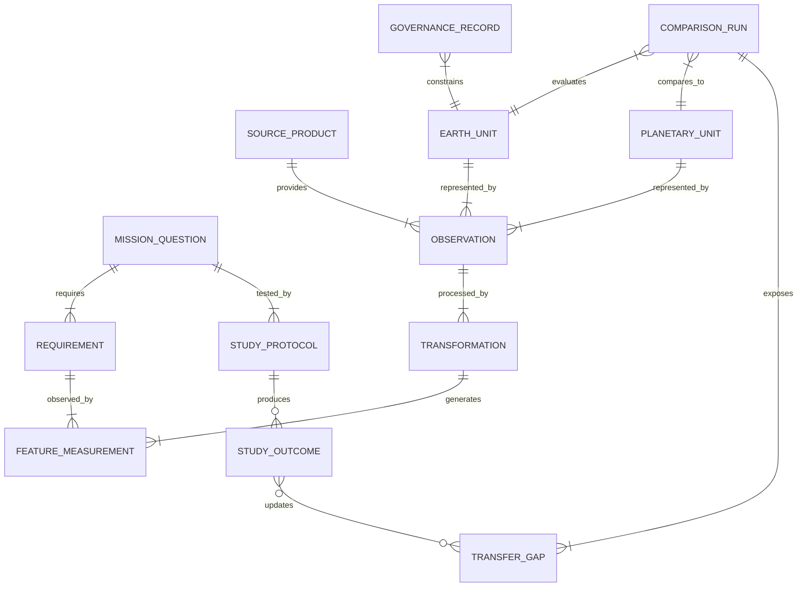

# 06 — Evidence Graph and Provenance

## Purpose

Evidence is the compounding asset of Planetary Analog OS. The graph exists to make every output auditable and every future result updateable. It is not a visualization ornament.

## Entity model

| Entity | Required fields | Example |
|---|---|---|
| `MissionQuestion` | id, task, purpose, owner, maturity | Map-scale route-study question |
| `Requirement` | id, semantic definition, unit, threshold/range, support, claim status | Slope distribution at 500 m window |
| `PlanetaryUnit` | body, geometry, CRS, source refs, support, quality | Bounded MOLA unit |
| `EarthUnit` | geometry, source refs, access/governance status | Bounded 3DEP unit |
| `SourceProduct` | provider, product ID/version, URL, terms, checksum | MOLA MEGDR release |
| `Observation` | time, location, measurement, quality, support | DEM tile or field observation |
| `Transformation` | software, method, parameters, input/output hashes | Common-support aggregation |
| `FeatureMeasurement` | value/distribution, unit, window, uncertainty, lineage | Relief distribution |
| `ComparisonRun` | profile, code version, scenario, result state | Pareto comparison |
| `TransferGap` | category, status, rationale, evidence, next test | Regolith mechanics not assessed |
| `StudyProtocol` | hypothesis, measurements, criteria, constraints, maturity | Draft protocol |
| `StudyOutcome` | protocol ref, outcome data, conditions, review | Future field result |
| `Claim` | text, class, support refs, approval status | “morphology differs at support X” |
| `GovernanceRecord` | permission, sensitivity, steward, consent status | Restricted coordinate flag |

## Relationship vocabulary

```text
MissionQuestion REQUIRES Requirement
Requirement OBSERVED_BY FeatureMeasurement
FeatureMeasurement DERIVED_FROM Observation
Observation PROVIDED_BY SourceProduct
FeatureMeasurement GENERATED_BY Transformation
EarthUnit REPRESENTED_BY Observation
PlanetaryUnit REPRESENTED_BY Observation
ComparisonRun COMPARES EarthUnit TO PlanetaryUnit
ComparisonRun EVALUATES Requirement
TransferGap LIMITS Claim
StudyProtocol TESTS MissionQuestion
StudyOutcome EXECUTES StudyProtocol
StudyOutcome UPDATES TransferGap
GovernanceRecord CONSTRAINS EarthUnit
Claim SUPPORTED_BY EvidenceItem
Claim REJECTED_BY EvidenceItem
```

## Graph diagram



## Provenance implementation stages

### v0.1

- Stable string/UUID IDs.
- JSON/YAML manifests and edge records.
- A relational-style normalized schema or Parquet artifacts.
- Human-readable provenance trace.
- Hashes on source and output artifacts.

### Research platform

- PostgreSQL/PostGIS for transactional records.
- Object store for immutable data assets.
- Event/audit trail for changes.
- Graph queries/materialized views where workflow justifies them.
- W3C PROV-O or compatible export mapping where useful.

### Infrastructure

- Federated provenance, agency data sovereignty, controlled-access graph edges, signed study packages, versioned vocabularies, and durable identifiers.

Do not begin with Neo4j, blockchain, or a distributed ledger. Graph structure is a data model; database choice follows actual query and governance needs.

## Evidence status transitions

```text
U0 → S1 → M2 → C3 → R4
```

Transitions require named evidence and reviewer action. No automatic upgrade because a pipeline ran.

## Claim lineage query

For any displayed claim `c`, the application must resolve:

```text
Claim c
  → comparison run
  → requirement(s)
  → feature measurement(s)
  → transformation(s)
  → input observation(s)
  → source product(s) + exact version + terms
  → uncertainty + sensitivity + limitations
```

If any edge is absent, the value is hidden from the “verified result” surface.

## Evidence graph APIs (future)

Possible read endpoints:

```text
GET /v1/studies/{id}
GET /v1/requirements/{id}
GET /v1/terrain-units/{id}
GET /v1/comparisons/{id}
GET /v1/claims/{id}/evidence
GET /v1/protocols/{id}
GET /v1/outcomes/{id}
```

API design is future-stage. v0.1 may load static JSON. No backend is required.

## Audit events

Any future change to source, metric, result, constraint, or claim records:

- actor or automation identity;
- timestamp;
- previous and new values;
- reason;
- evidence attachment;
- approval status.

Negative findings are immutable evidence, not overwritten by a later preferred result.
