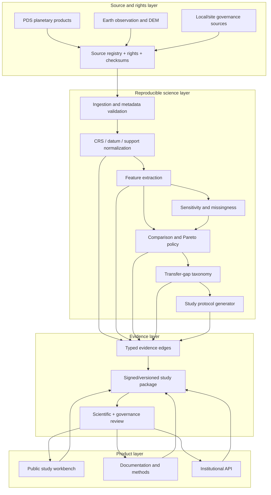

# 07 — Platform Architecture

## Architectural thesis

Planetary Analog OS is an evidence system with a product surface, not a collection of dashboards. The architecture must preserve the chain from a mission question to a measurable comparison, a transfer-gap statement, and a future outcome.

The system is therefore designed around **immutable study packages** and **versioned evidence**, not around real-time API calls or a hidden recommendation service.

## Horizon architecture

```text
H0  Public prototype
    Static app + offline artifacts + source/evidence manifests

H1  Research platform
    Study workspaces + PostGIS + object storage + review workflows

H2  Institutional platform
    SSO/RBAC + private sources + audit logs + APIs + integrations

H3  Interoperability layer
    Cross-agency vocabularies + signed evidence packages + federation

H4  Planetary analog network
    Governed sites + field/simulation outcomes + calibrated transfer evidence
```

## Logical components

| Component | Responsibility | v0.1 | H1+ |
|---|---|---:|---:|
| Source registry | Product identity, version, terms, checksum, coverage | static YAML/JSON | service + object store |
| Mission ontology | Task, requirement, observable, threshold, gap | one profile | versioned registry |
| Terrain processor | AOI, CRS, support, masks, features | offline Python | batch workers |
| Comparison engine | Eligibility, feature distances, Pareto/tie state | offline artifact | API/service |
| Gap engine | Non-transferable and unknown conditions | static taxonomy | governed ontology |
| Protocol planner | Draft study design and next evidence | template generator | protocol workflow |
| Evidence graph | Nodes/edges from source to claim/outcome | edge JSON/Parquet | Postgres/graph views |
| Review workflow | Scientific, community, safety, rights review | docs/checklist | role-based approvals |
| Public app | Explainable study experience | static React | multi-tenant web app |
| Data catalog | Searchable planetary/Earth/site assets | pinned bundle | STAC/OGC federation |
| Outcome ledger | Pre/post-study outcomes | schema only | field/simulation records |
| Evaluation harness | Fixtures, ablations, metrics | CI scripts | benchmark service |

## Reference architecture



## v0.1 deployment topology

```text
Browser
  ├── static HTML/JS/CSS
  ├── pinned comparison artifacts
  ├── evidence-edge bundle
  └── offline fallback

CI
  ├── validate schemas
  ├── run scientific fixtures
  ├── build artifacts
  ├── build app/docs
  ├── run accessibility/E2E/link checks
  └── publish immutable release
```

There is no unauthenticated runtime computation endpoint in v0.1. This minimizes attack surface and ensures that a service outage cannot invalidate the demonstration.

## H1 service boundary

When repeated research usage justifies a platform, split services at evidence boundaries:

1. **Catalog service** — source and terrain-unit metadata.
2. **Study service** — mission profiles, requirements, runs, protocols.
3. **Compute service** — asynchronous processing with reproducible job specifications.
4. **Evidence service** — nodes, edges, claims, review states.
5. **Governance service** — access, sensitivity, permissions, consent, expiry.
6. **Outcome service** — field/simulation results and updates.
7. **Presentation API** — user-specific views over approved evidence.

Do not split these into microservices until there are separate scaling, security, or ownership requirements. A modular monolith is the default H1 architecture.

## Study package as the durable unit

A study package is a portable, inspectable directory/archive:

```text
study-package/
  study.json
  mission-profile.json
  source-lock.json
  terrain-units.geojson
  method.yml
  feature-measurements.parquet
  comparison-runs.json
  sensitivity-runs.json
  transfer-gaps.json
  protocol.json
  evidence-edges.json
  evaluation-summary.json
  claims.json
  checksums.txt
  README.md
```

The package can be reviewed without the live platform. This is essential for agencies, universities, offline field teams, and long-term archival.

## Scalability model

| Load | Architecture | Trigger |
|---|---|---|
| 1–10 canonical studies | Static artifacts | v0.1 |
| 10–1,000 studies | Postgres/PostGIS + object store + batch jobs | Repeated research users |
| 1,000–100,000 studies | Queue workers, cache, catalog federation, signed packages | Institutional adoption |
| Multi-agency federation | Tenant isolation, policy engine, data sovereignty, federation protocol | External organizations and restricted data |
| Global network | Regional data planes, immutable evidence, shared ontology governance | Independent organizations publishing outcomes |

## Architecture quality attributes

- **Traceability:** every claim resolves to evidence.
- **Reproducibility:** same inputs/configuration produce the same artifact within declared tolerances.
- **Explainability:** result decomposition is visible.
- **Uncertainty preservation:** unknown is not silently converted to certainty.
- **Portability:** study packages work outside the hosted platform.
- **Data sovereignty:** restricted records need not leave their jurisdiction.
- **Accessibility:** core conclusions do not depend on a map or WebGL.
- **Cost discipline:** compute is offline/batch unless user value requires live work.
- **Graceful degradation:** missing source/API produces a bounded result, not an invented one.

## Architecture decision records

Create and maintain ADRs for:

- body/region/task scope;
- source/product selection;
- common-support policy;
- coordinate/vertical datum rules;
- feature definitions;
- Pareto/tie decision;
- provenance schema;
- static versus live compute;
- rights/sensitive location policy;
- AI exclusion/inclusion;
- release maturity language.

An ADR is not complete until it records decision, alternatives, evidence, consequences, and reversal trigger.
