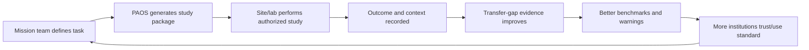

# 14 — Moat, Network, and Infrastructure

## What is not a moat

- A map UI.
- A generic geospatial stack.
- A prompt wrapper.
- A single similarity formula.
- A public dataset anyone can download.
- A claim that an embedding model understands planets.

## Compounding asset

The compounding asset is a **validated transfer evidence graph**:

```text
pre-study requirement
  + source/product configuration
  + Earth terrain/site conditions
  + transfer assumptions
  + protocol
  + measured field/simulation outcome
  + residual error/gap
  + independent review
```

Each high-quality outcome improves future protocol selection, limitation warnings, benchmark quality, and institutional trust.

## Moat layers

| Layer | Why it can compound | Copy risk |
|---|---|---|
| Mission/requirement ontology | Shared vocabulary across tasks and organizations | Open ontology can be copied; adoption/community makes it sticky |
| Provenance/evidence schema | Makes claims reviewable and comparable | Standards are copyable; network use creates switching cost |
| Benchmark suite | Allows honest comparison of methods | Early benchmarks can be reproduced; outcome depth matters |
| Outcome records | Pre/post evidence is expensive to gather and structure | Stronger if governed, reviewed, and longitudinal |
| Site/governance network | Access, rights, local relationships, and protocols are not just data | Trust and legitimacy are slow to earn |
| Integrations | Embedded in mission/GIS/robotics workflow | Switching cost after repeated use |
| Review reputation | Reliable claim boundaries and negative results | Institutional credibility compounds |

## Network loop



This loop has a major risk: low-quality outcome data can create a negative network effect. Quality gates and governance are mandatory.

## Standardization strategy

Publish open, versioned schemas for:

- mission task/requirement;
- planetary/Earth terrain unit;
- source/product lock;
- feature measurement;
- transfer gap;
- study protocol;
- study outcome;
- governance/access status;
- claim/evidence record.

Use existing standards where suitable:

- STAC for data discovery;
- GeoJSON/GeoParquet for geometry/features;
- OGC APIs for future interoperability;
- W3C PROV mappings for provenance;
- schema versioning and stable IDs.

Do not make the network dependent on proprietary storage or an unexportable SaaS database.

## Partner roles

- Space agencies: mission context and research programs.
- Universities: methods and outcomes.
- Site stewards: governance and field conditions.
- Local communities/Indigenous authorities: rights, knowledge, consent, benefit.
- Robotics labs: performance and test outcomes.
- Standards organizations: interoperability.
- Data providers: source quality/terms.
- Funders: public-good infrastructure and open research.

## Network quality levels

```text
N0  Named site/source lead
N1  Source-verified terrain unit
N2  Reproducible study package
N3  Authorized study protocol
N4  Completed outcome with context
N5  Independently reviewed transfer record
N6  Reused/validated across tasks or organizations
```

Do not market a site as “validated analog” below N5.

## Infrastructure transition triggers

Move from product to standard/network focus only if:

- at least three independent organizations reuse a study schema;
- multiple outcomes are captured under the same ontology;
- reviewers agree the evidence graph reduces ambiguity;
- site/governance participants accept the model;
- a public benchmark is used externally;
- the product is not merely a custom-consulting wrapper.

## Defensibility test

Ask a strong GIS company to copy the v0.1. It should be able to. That is healthy. The long-term question is whether it can reproduce:

- approved ontology decisions;
- longitudinal outcome data;
- governed site relationships;
- review reputation;
- interoperable ecosystem adoption.

If not, the moat is not real yet.
