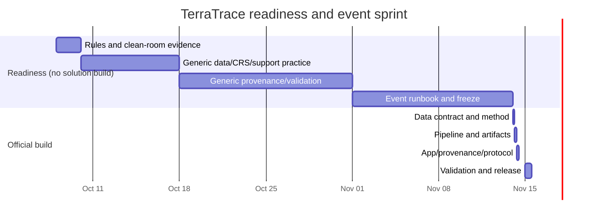

# 16 — 39-Day Execution and Gates

## Calendar truth

- October 8–November 13: readiness only under the official no-predevelopment rule.
- November 14–15: actual challenge build/submission.
- Inclusive span October 8–November 15: 39 calendar days.

This is not a 39-day solution implementation. It is a 37-day readiness window plus a two-day official build sprint.

## Capacity plans

| Plan | Readiness hours | Event hours | Total | Decision |
|---|---:|---:|---:|---|
| Ceiling | 215 | 25 | 240 | Ambitious upper bound; requires sustainable daily rhythm |
| Governing | 185 | 25 | **210** | Recommended |
| Emergency | 135 | 15 | 150 | Use if life/availability/data issues reduce capacity |

No day above 8 focused hours. Include sleep, meals, movement, and a recovery/light block each week.

## Readiness work blocks

| Dates | Governing hours | Output | Gate |
|---|---:|---|---|
| Oct 8–9 | 18 | Official rules/source packet, claim firewall, clean-room policy, roles | P0 |
| Oct 10–12 | 22 | Generic source/data-literacy checklist, license/retrieval practice, tool verification | P1 |
| Oct 13–17 | 28 | Generic synthetic terrain/CRS/support exercises, fixture/test templates | P2 |
| Oct 18–24 | 30 | Generic provenance/schema/docs/accessibility practice; no challenge-derived artifacts | P2 review |
| Oct 25–31 | 30 | Clean-room event runbook, blank config patterns, generic CI/build rehearsal | Readiness review |
| Nov 1–7 | 30 | Generic demo/release rehearsal, claim audit drill, user-test script | Readiness review |
| Nov 8–13 | 27 | Freeze readiness, rest plan, event-hour checklist, source inspection order | P3 |

**Readiness output rule:** None of these blocks may produce a challenge-specific comparison, derived artifact, UI, or submission asset.

## Event sprint — November 14

| Time IST | Hours | Work | Acceptance |
|---|---:|---|---|
| 09:00–09:30 | 0.5 | Create clean project repository and event-start commit | Project history begins after official start |
| 09:30–11:30 | 2 | Inspect exact products; select 1 Mars + 2 Earth bounded units | G1 data contract passes |
| 11:30–13:00 | 1.5 | Lock method/support/features | G2 method contract passes |
| 14:00–16:00 | 2 | Build fixtures and scientific pipeline | Fixtures pass first |
| 16:00–18:00 | 2 | Generate artifacts/passports/provenance | Schemas validate |
| 18:30–21:00 | 2.5 | Build comparison app and gap ledger | Core path works offline |
| 21:00–22:30 | 1.5 | Generate protocol, tie/block states, evidence trace | G3 vertical slice |
| 22:30–23:30 | 1 | Deploy checkpoint, record defects, rest | No hidden P0 |

## Event sprint — November 15

| Time IST | Hours | Work | Acceptance |
|---|---:|---|---|
| 08:30–10:30 | 2 | Sensitivity, missingness, Pareto/tie audit | G4 passes or recommendation language removed |
| 10:30–12:00 | 1.5 | Independent reread/re-derivation and claim removal | Every public number C3+ |
| 12:45–14:15 | 1.5 | Accessibility/mobile/offline audit | Canonical path works without pointer/map |
| 14:15–16:00 | 1.75 | README/docs/evaluation/limitations | G5 claims consistent |
| 16:30–18:00 | 1.5 | Clean build, tests, manifest/checksums | G6 truthful reproduction |
| 18:00–19:30 | 1.5 | Screenshots/video/submission narrative | Video matches build |
| 19:30–21:00 | 1.5 | Submit early and verify | Receipt saved |
| 21:00–22:30 | 1.5 | Adversarial final audit | G7 release lock |
| 22:30–23:30 | 1 | Release blockers only | Final tag/package |

## Critical path

## Hard gates

| Gate | Pass | Failure action |
|---|---|---|
| P0 | Official conduct/rules evidence saved | Stop challenge-specific prep |
| P1 | Source/product rights route available | Do not preselect sites |
| P2 | Generic pipeline literacy demonstrated | Simplify event method |
| P3 | Clean-room readiness, no solution artifacts | Enter event with scope only |
| G1 | One Mars + two Earth units meet contract | Transfer audit/no ranking |
| G2 | Features valid at support | Reduce feature set |
| G3 | Offline profile→comparison→gap→protocol | Freeze extras |
| G4 | Sensitivity/fixtures/missingness pass | Remove recommendation language |
| G5 | Claims/user interpretation pass | Delete overclaim |
| G6 | Clean build/manifest pass | State actual scope honestly |
| G7 | Submission package coherent | Blocker repair only |

## Emergency cutline

Keep only:

- 1 Mars unit;
- 2 Earth units;
- 3 morphology features;
- static table and evidence trace;
- gap ledger;
- one draft protocol;
- fixtures/source lock/docs/video.

Cut map sophistication, third sites, imagery, ML, translations, dynamic search, and animation first.

## Daily operating rhythm

- Start: one critical gate and one evidence target.
- Work: 90-minute focus blocks, no unbounded exploration.
- End: record actual result, unresolved question, next gate, and whether an assumption changed.
- Never convert a failed gate into a prose caveat and continue as if it passed.
