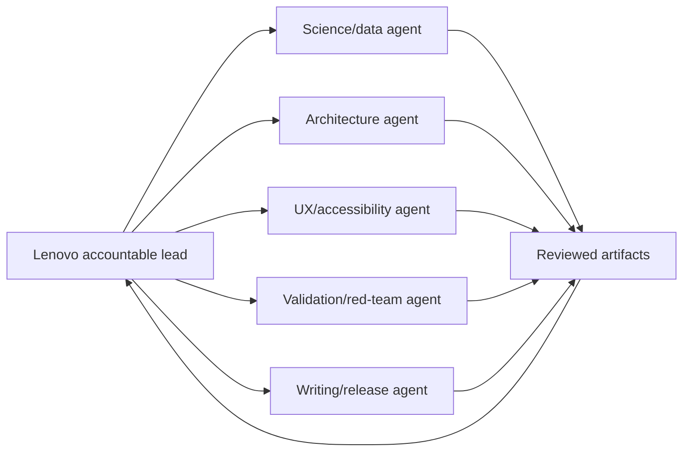

# 17 — Team, AI Agents, and Operating Model

## Operating assumption

Lenovo is the accountable lead. AI agents accelerate research, drafting, tests, and review but do not own scientific claims. Before the official event, agents may assist only with generic readiness tasks permitted by the competition rules.

## Roles

| Role | Responsibility | Decision authority |
|---|---|---|
| Product/science lead | Scope, claim firewall, mission ontology, final scientific interpretation | Final product/science approval |
| Data steward | Source files, terms, checksums, metadata, support contract | Can block use of a source |
| Geospatial scientist | CRS, datum, support, feature algorithms | Can block a metric |
| Validation lead | Fixtures, baselines, ablations, independent checks | Can block a claim |
| UX/accessibility lead | First-minute flow, explanation, keyboard/mobile path | Can block release usability |
| Security/release lead | Dependencies, manifests, CI, deploy, evidence package | Can block release integrity |
| Writer/presenter | Docs, README, script, submission package | Must not alter claims without review |

One person can hold all roles, but the roles remain separate in the checklist.

## AI-agent topology



## Strict scope boundaries

| Agent | May edit | Must not edit |
|---|---|---|
| Science/data | `pipeline/`, `schemas/`, source/method docs | UI copy, claims, license decisions without review |
| Architecture | architecture/docs, interfaces, CI design | scientific metric implementation without science review |
| UX | `web/`, UX/docs/tests | source/data/equation truth |
| Validation | `tests/`, `evaluation/`, review reports | production claims or source selection |
| Writing/release | `README`, `docs`, video/script, manifests after approval | scientific results, legal statements, evidence status |

Agents return out-of-scope findings instead of editing another stream.

## Agent task contract

Every task prompt contains:

```text
Objective
Allowed files/scope
Inputs and evidence status
Expected artifacts
Acceptance tests
Known non-goals
Claims the agent may not make
Report format
```

Every agent result is labeled:

```text
GENERATED — not trusted yet
REVIEWED — human checked content/logic
VERIFIED — tests/source evidence support it
RELEASED — included in immutable package
```

## Review loop

```text
agent proposes
→ lead inspects diff/artifact
→ contradictory test/source check
→ targeted correction
→ test and evidence update
→ claim status promotion
```

Never accept an agent’s source citation, metric, or numeric result solely because it sounds plausible.

## Parallel work rule

Parallelize independent work; sequence shared contracts:

- source lock before features;
- schema before producer/consumer implementation;
- metric definition before UI label;
- validation fixture before optimization;
- claim approval before demo copy.

## Daily status format

```markdown
Date:
Role(s):
Completed evidence:
Gate status:
What would disprove the current plan:
Changed assumptions:
Blocked by:
Next critical action:
Hours used / remaining:
```

## Meeting/review protocol

At every gate, ask:

1. What exact file/artifact proves pass?
2. What result would prove us wrong?
3. Which claim is currently strongest and least supported?
4. What must be removed if the gate fails?
5. Is the issue scientific, legal/governance, product, or schedule?

## Human responsibility

Lenovo must personally approve:

- selected source products;
- common-support rule;
- feature definitions;
- transfer-gap labels;
- public claims;
- data licensing/redistribution plan;
- final demo and submission;
- any statement about NASA or agencies.
