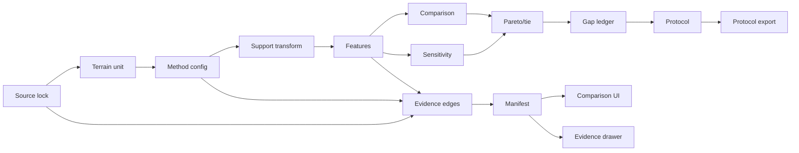

# 21 — Implementation Backlog

## Backlog conventions

- `P0`: must exist for a truthful v0.1.
- `P1`: high-value if the core is green.
- `P2`: post-event/platform work.
- Every item has an artifact and acceptance test.

## P0 — science and data

| ID | Deliverable | Acceptance |
|---|---|---|
| S-001 | Source lock schema | Invalid product/terms/status fails validation |
| S-002 | Terrain-unit schema | Bounded geometry, body, CRS, support, quality, rights fields required |
| S-003 | Method configuration | Windows, thresholds, masks, support, versions serialized |
| S-004 | Common-support transform | Synthetic known-scale test passes |
| S-005 | Slope feature | Plane fixture matches analytic slope |
| S-006 | Relief feature | Quantile fixture matches expected values |
| S-007 | Ruggedness feature | Detrended fixture and units documented |
| S-008 | Connectivity feature | Component fixture and neighborhood policy pass |
| S-009 | Distribution comparison | Identical fixture gives zero/near-zero distance |
| S-010 | Missingness propagation | Low valid fraction yields blocked/unknown |
| S-011 | Sensitivity runner | Scenario matrix and rank flips generated |
| S-012 | Pareto/tie policy | Known vector fixture passes |
| S-013 | Transfer-gap ledger | Every result has T-class gap records |
| S-014 | Draft protocol generator | Valid study result emits required fields |

## P0 — evidence and release

| ID | Deliverable | Acceptance |
|---|---|---|
| E-001 | Evidence edge schema | Claim trace resolves to source/transform |
| E-002 | Artifact manifest | All output hashes and versions present |
| E-003 | Claim ledger | UI/README claims have status and refs |
| E-004 | Offline bundle | Prepared flow works without network |
| E-005 | Reproducibility script | Clean run is recorded truthfully |
| E-006 | License/citation page | Every source and asset credited |
| E-007 | Limitations page | Forbidden claims visible |

## P0 — application

| ID | Deliverable | Acceptance |
|---|---|---|
| U-001 | Scope ribbon | User sees map-scale/not-validation boundary |
| U-002 | Profile screen | Requirements/units/status visible |
| U-003 | Comparison table | Per-feature metrics, support, uncertainty visible |
| U-004 | Sensitivity state | Stable/sensitive/tie/blocked visible |
| U-005 | Gap ledger | Transfer limitations explicit |
| U-006 | Evidence drawer | One value traces to source and transform |
| U-007 | Protocol export | Draft protocol downloads and matches result |
| U-008 | No-map path | Keyboard/text flow produces same conclusion |

## P1 — polish

- Static contextual map with validated overlays.
- Additional third Earth unit.
- Better table sorting/filtering.
- Screenshot-quality evidence chain.
- Mobile layout polish.
- More complete docs search/navigation.
- External reviewer feedback.

## P2 — research platform

- Study workspace.
- Postgres/PostGIS.
- Private sources and role review.
- Outcome ledger.
- Protocol/outcome comparison.
- Multi-task ontology.
- Controlled site network.
- API and STAC/OGC federation.
- Calibrated model after outcome corpus.

## Dependency graph

## Backlog stop order

If time is lost, cut in this order:

1. Animation.
2. Dynamic/live discovery.
3. Third Earth unit.
4. Image-context layers.
5. Map interaction.
6. Additional metrics.
7. Extra copy/polish.

Do not cut:

- source status;
- common-support rule;
- feature units/definitions;
- sensitivity;
- tie/blocked state;
- provenance;
- limitations;
- offline path;
- docs/citation;
- release acceptance tests.
