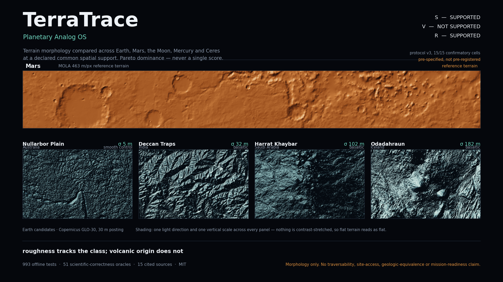
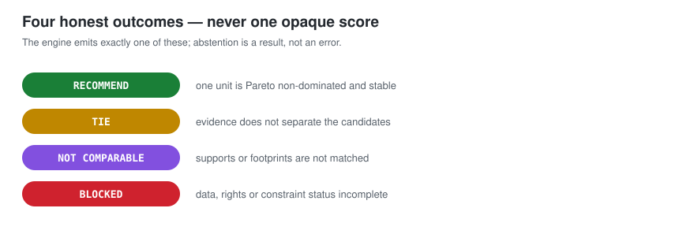

# Planetary Analog OS — TerraTrace

[](https://github.com/pal-123456789/terratrace/actions/workflows/ci.yml)

**Map-scale terrain-morphology analog screening across five worlds — Earth, Mars, the Moon, Mercury, and Ceres.**

Built for the NASA Space Apps Challenge 2026 challenge *“Identify Earth Locations that Analog the
Permanent Moon Base Locations and Mars”* — as **published prior art extended inside the event
window**, with the pre-event state and the in-window commits both disclosed. See
[`EVENT-ALIGNMENT.md`](terratrace/docs/EVENT-ALIGNMENT.md) and
[`EVENT-WINDOW-CONTRIBUTION.md`](terratrace/docs/EVENT-WINDOW-CONTRIBUTION.md).

> **Challenge title confirmed** — read from the submission portal on 2026-11-15, the second day of
> the event. It had been the one unverifiable claim in the submission (the challenge index is
> client-rendered and its GraphQL endpoint refuses non-browser requests); the route that failed, and
> the confirmation that closed it, are both recorded in
> [`EVENT-ALIGNMENT.md`](terratrace/docs/EVENT-ALIGNMENT.md) §6.

## If you have 30 seconds

**The problem.** Finding an Earth terrain that "looks like" Mars is easy. Designing a comparison whose
result survives the scale it was measured at, the data it was measured from, and the descriptors it was
measured with is hard — and a false analog is expensive, because someone eventually builds on it.

**What this does.** TerraTrace compares the *shape* of landscapes at a declared common spatial support
and answers three questions **separately**: which candidate is least dissimilar (**ranking**), whether
any candidate lies inside the reference's own variability (**adequacy**), and whether the evidence is
strong enough to answer either (**sufficiency**). It never collapses them into a score, and
`verdicts.py` refuses one structurally.

**What is genuinely different.** Not the similarity map — the refusal machinery. It publishes the
analog claim it withdrew about itself, it lists every cell where it abstains, and its atlas **will not
write a file** if two of its six committed records disagree.

**The strongest result.** A pre-registered Mars test withdrew the project's own attractive finding —
that a famous basalt field was the closest match — and protocol v3 then showed why: smoothness tracks
the terrain class, **volcanic origin does not** (3/3 plains support smoothness; 0/3 support volcanic
specificity). The engine's sharpest output is a claim it disproved about itself.

**What it cannot establish.** Map-scale morphology only — no traversability, geologic equivalence, site
access or mission readiness. Its lunar half is **exploratory** and is labelled that way on the same
page as the result: the absolute question is unanswered at every lunar cell, and the lunar
sole-winner turns out to be a property of the Pareto rule rather than of a candidate.

**Demo in one command.** `bash terratrace/scripts/reproduce_all.sh` — the suite, the scientific
oracles, the documentation guard, the atlas and the independent-axis probe. No network, no API key.

📄 **[Submission page](terratrace/docs/SUBMISSION.md)** · **[7-slide submission deck](TerraTrace-submission.pdf)** ([PowerPoint](TerraTrace-submission.pptx)) · **[full 10-slide project deck](TerraTrace-deck.pdf)** · **[evidence map](https://terratrace.fit/atlas/)**

This repository holds two things:

| Path | What it is |
|---|---|
| `terratrace/` | The working engine (pure-NumPy): real DEMs → per-body metric reprojection → morphology descriptors → Pareto decision across six robustness lenses → honest uncertainty → transfer-gap ledger → provenance, report, and viewer. **1044 tests**, no network required. |
| `site/` | A 3D scroll-animated website telling the project story — live at **<https://terratrace.fit>**. |

**Project deck — 10 slides.** [PDF](TerraTrace-deck.pdf) · [PowerPoint](TerraTrace-deck.pptx) — the whole project: the question, the pipeline across five bodies, the measurement layer, the benchmark that made us withdraw our own finding, the result, the verification evidence, the data path, the claim firewall and the open items.

> **Scope / claim firewall.** TerraTrace screens terrain **morphology** between curated
> map products. It does **not** estimate rover traversability, validate autonomy,
> establish geological equivalence, certify site access, or certify mission readiness.
> It is not NASA-endorsed.

## What it does

Loads real elevation models (Mars MOLA; Moon LOLA; Mercury MESSENGER; Ceres Dawn; Earth
Copernicus GLO-30/90, USGS 3DEP, SRTM, NASADEM, ALOS — a 15-product catalog with coverage,
licence, and vertical-accuracy metadata), warps each AOI to its own local metric grid on the
correct body, computes map-scale descriptors (slope, relief, ruggedness, connectivity,
curvature, vector ruggedness, roughness/Hurst, topographic openness, geomorphon landforms,
spectral slope, directional fabric, …),
and ranks candidate terrains by **Pareto dominance** — never a composite "Mars-likeness" score.
It returns a recommendation only when it survives five independent decision lenses (core,
extended, geomorphic, landform, texture; a sixth, hydro, is opt-in via `decision_metrics`), reports an honest TIE/INDETERMINATE/BLOCKED state
otherwise, and carries measurement uncertainty, a spatial block-bootstrap, significance tests,
a transfer-gap ledger, and a full provenance appendix. On request it also attaches a map-scale
**scale & fabric** layer — a radially-averaged power spectrum (spectral slope, band roughness,
peak wavelength) and a directional-fabric descriptor (anisotropy strength and orientation) per
unit — rendered as a "Scale & fabric" section in the report and viewer. Every recommendation can
also carry a
one-sided **permutation p-value vs the runner-up** (the second-closest candidate) and a
**non-composite confidence verdict** (`robust` / `qualified` / `fragile` / …) that restates the
bootstrap, significance, and lens/support evidence as three independent signals — never a
weighted score, and never a traversability, hazard, geologic-equivalence, or mission-readiness
claim. Everything is reproducible and hash-anchored; a self-contained HTML report and offline
viewer are generated per study.



## Where to read what

Every claim in this repository is written down, and `terratrace/scripts/doc_consistency_check.py`
— a CI step, backed by always-on tests in the suite — **fails the build if the prose drifts from
the code**: a stale test
count, a documentation page missing from the nav, a relative link that no longer resolves, or a
version that disagrees between `__init__.py`, `pyproject.toml` and `CITATION.cff`.

| Document | What it is |
|---|---|
| [`README.md`](README.md) | This file — what the project is, and how to run it |
| [`terratrace/README.md`](terratrace/README.md) | The engine: every capability, the CLI, the HTTP API, the layout |
| [`terratrace/docs/method.md`](terratrace/docs/method.md) | Every descriptor and every decision lens, in full |
| [`terratrace/docs/RESULTS-v3.md`](terratrace/docs/RESULTS-v3.md) | **The current headline result** |
| [`terratrace/docs/BENCHMARK-PROTOCOL-v3.md`](terratrace/docs/BENCHMARK-PROTOCOL-v3.md) | Its frozen protocol, including the pre-specification caveat |
| [`terratrace/docs/RESULTS-v2.md`](terratrace/docs/RESULTS-v2.md) | The pre-registered test that withdrew the earlier claim |
| [`terratrace/docs/PAPER.md`](terratrace/docs/PAPER.md) · [PDF](terratrace/docs/TerraTrace-paper.pdf) | The methods paper (typeset PDF included) |
| [`terratrace/docs/CLAIM-LEDGER.md`](terratrace/docs/CLAIM-LEDGER.md) | Every claim → its experiment, status, uncertainty, falsifier |
| [`terratrace/docs/VALIDATION.md`](terratrace/docs/VALIDATION.md) | The whole test suite and all 51 scientific-correctness oracles |
| [`terratrace/docs/limitations.md`](terratrace/docs/limitations.md) | The claim firewall and the honest limits |
| [`terratrace/docs/FEATURES.md`](terratrace/docs/FEATURES.md) | Every descriptor: definition, unit, window, citation, and what it may **not** support |
| [`terratrace/docs/ACCESSIBILITY.md`](terratrace/docs/ACCESSIBILITY.md) | The nine accessibility non-negotiables, audited line by line |
| [`terratrace/docs/PLAN-COMPLIANCE.md`](terratrace/docs/PLAN-COMPLIANCE.md) | The project's master plan traced item by item, with the open list named |
| [`terratrace/docs/DEMO.md`](terratrace/docs/DEMO.md) | A 2½-minute demo script mapped to the live site |
| [`terratrace/docs/ATLAS.md`](terratrace/docs/ATLAS.md) | The multi-reference, multi-lens analog atlas |
| [`terratrace/REAL-DATA-RUNBOOK.md`](terratrace/REAL-DATA-RUNBOOK.md) | Running it on real data — keyless |
| [`terratrace/CLEAN-ROOM-NOTE.md`](terratrace/CLEAN-ROOM-NOTE.md) · [`eligibility-evidence.md`](terratrace/docs/event/eligibility-evidence.md) | The event-eligibility stance and its evidence trail |
| [`CHANGELOG.md`](CHANGELOG.md) | The full build history |
| [`TerraTrace-PROJECT-BRIEF.md`](TerraTrace-PROJECT-BRIEF.md) | An internal strategic brief (dated; not the submission) |

The dated records — the v1/v2 protocols, the superseded v3 proposal, and the exploratory worked
example — are kept verbatim under `terratrace/docs/` so the audit trail is intact.

## Run the engine

```bash
cd terratrace
pip install -r requirements.txt            # core (NumPy only)
python tests/run_tests.py                   # 1044 fixtures, offline
python scripts/run_validation.py            # scientific-correctness suite
python -m terratrace.cli --out artifacts    # synthetic study
python -m terratrace.build_viewer           # viewer/index.html
```

Unified CLI: `python -m terratrace.cli {study, batch, validate, benchmark, report, report-html,
dossier, references, sensitivity, classify, confidence, bank, transect, version}`. Every planetary
body is keyless (Mars MOLA, Moon LOLA, Mercury MESSENGER, Ceres Dawn), and — see below — so is the
**matched-footprint benchmark's** Earth path, which reads the public ESA Copernicus GLO-30 COG mosaic
on AWS with no account. (The multi-body analog orchestrator and the non-Copernicus Earth products use
OpenTopography, which needs a free `OPENTOPO_API_KEY`.) The large
DEMs under `terratrace/data/` are git-ignored; fetch them with
`terratrace/scripts/fetch_real_dems.py`. A single command —
`terratrace/scripts/run_real_analog_study.py` — runs the whole real multi-body pipeline end to end
(config → preflight → fetch → full-depth study → decision confidence → a complete bundle); see
`terratrace/REAL-DATA-RUNBOOK.md`.

## The headline result

**TerraTrace caught its own false analog.** Exploratory real-data runs (Mars MOLA vs three Earth
terrains) favoured Craters of the Moon, Idaho — a well-known basalt analog — and it would have been
easy to stop there. Instead the preference was tested under a protocol **frozen before the data were
seen**: matched physical footprints, supports at or above MOLA's effective resolution, three held-out
Martian volcanic plains, and two contrast terrains. It did not survive: the engine abstains for all
seven Mars references in the honest regime, and Craters is nearest for a cratered highland as readily
as for volcanic plains — a non-specific "least-dissimilar member of a weak shortlist" effect, not a
specific analog. Results: `terratrace/docs/RESULTS-v2.md`; frozen protocol:
`terratrace/docs/BENCHMARK-PROTOCOL-v2.md`; claim-to-evidence ledger: `terratrace/docs/CLAIM-LEDGER.md`.
The method write-up is `terratrace/docs/PAPER.md`; the earlier exploratory runs remain in
`terratrace/docs/REAL-EXAMPLE.md` (marked superseded). The multi-reference **analog atlas** is
documented in `terratrace/docs/ATLAS.md`.

**Then the explanation was tested, not asserted.** Protocol v3 added two **smoothness-matched
non-volcanic** Earth controls — the Nullarbor limestone plain and the Llano Estacado sedimentary
plain — 60 km windows for statistical power, and three fresh confirmatory Martian volcanic plains
alongside two fresh cratered highlands. The frozen v3 rules returned **S supported, V not
supported**: for **every** confirmatory volcanic plain, at **every** honest support, a smooth
**non-volcanic** terrain is on the Pareto front, while basaltic origin confers no advantage — the
basalts come to the front only for the *rough* highlands. So the nearest Earth analog tracks
**km-scale roughness, not volcanic origin**. Resolution robustness held: of 15
confirmatory honest cells, 11 unchanged, 3 membership-changed, 1 destabilised and **0 reversed**
— no outright candidate reversal under the tested resolution-matching control. Recorded with two
honest caveats: v3 is *pre-specified but not fully pre-registered*, and its confirmatory verdicts
use the **core decision lens** (the other lenses are not independent replications). Results:
`terratrace/docs/RESULTS-v3.md`; protocol: `terratrace/docs/BENCHMARK-PROTOCOL-v3.md`; chronology
and config reconciliation: `terratrace/docs/V3-ARCHIVAL-CLARIFICATION.md`; independent-toolchain
re-derivation of two descriptors: `terratrace/docs/INDEPENDENT-GIS-REPRODUCTION.md`.


**And the lunar half is now on real lunar terrain.** All **six** published south-polar
candidate regions from the NASA Goddard PGDA 5 m/pixel LOLA products were ingested and screened
against the same Earth roster at a declared 500-1000 m support (each site is ~16 km across, so
it cannot share the 60 km Mars regime — and Mars is excluded rather than forced below its
source's resolution). Across **18 of 18** site × support cells the sole non-dominated Earth
candidate is the same: the **Nevada Basin & Range**, while the smooth non-volcanic controls that
answered for Martian volcanic plains are the worst matches. The membership also survives six of
the archive's own perturbed DEM realisations (its published error model), which is the correct
input for a propagation test — independent per-pixel noise would average away under aggregation
and manufacture stability.

Four caveats travel with it, and the second is the important one. The surviving candidate is not
always *close* (its worst axis is 12-71% away, i.e. least-dissimilar of a weak shortlist, and at
Shackleton rim no candidate is close at all). The three declared axes are **one axis**: `slope_deg`
and 3×3 `relief` are the same gradient measured two ways — `relief = 2 d tan(slope) · ρ` with ρ
bounded in `[1, √2]` and dependent only on the gradient's direction — verified against the engine's
own functions to 4.4e-16 m. A stress test declared in advance then attacked the panel with **30
counted perturbations** (window origin, support jitter, footprint 3-10.5 km, both alternative
resampling kernels, masking, DEM noise/tilt/smoothing, descriptor and candidate dropout, one added
candidate): **28 of the 30 perturbations** left it untouched and only **18 of 504 site × support
cells moved** — a cell-level stable fraction of 0.964, verdict **ROBUST** — with the two reversals
named rather than buried (a 3 km window changes the survivor; an added eighth candidate makes
Nevada a co-winner).

And the rest is reported as **three separate answers to three separate questions**, because a
ranking is not an adequacy statement. The definitive ordering sits next to an **adequacy verdict of
NOT_ESTABLISHED at all 18** cells — and the reason splits in two, which matters. At **6 of the 18
cells** both descriptor bands can be calibrated, and the reference's own variability band there is so
wide that it admits at least four of the five other lunar sites, so membership in it is not evidence of
similarity. At **the other 12** (every 750 m and 1000 m cell) there is **no relief band at all** — the
held-out sub-windows do not supply one at those supports — so the verdict rests on the slope band
alone, which also admits four or five. The verdict is unchanged and in fact rests on a *weaker* test at
those twelve; what a reader is owed is that the second band is missing rather than wide. Alongside it,
an evidence-sufficiency verdict of **marginal**, with the reasons named. Adding
those sibling sites as controls produced the least comfortable number in the project: at **18 of 24
site × descriptor statistics** the unit nearest a lunar reference is **another lunar site**, not any
of the seven Earth candidates. `earth_nevada_basin` is the closest **Earth** candidate everywhere,
exactly as claimed; it is not the closest *unit*. And it is all **exploratory** — six nearby sites
are not six independent tests and the ensemble is 6 of 100 published realisations. Full record,
tables, provenance and caveats: `terratrace/docs/LUNAR-DEMONSTRATION.md` and its pre-run fault line
`terratrace/docs/LUNAR-PROTOCOL-v2.md`; why the previously catalogued USGS endpoint still 404s:
`terratrace/docs/LUNAR-STATUS.md`.


![A definite ranking is not an adequacy result. On each descriptor the pale band is the lunar reference's distance from itself — the spread its own held-out sub-windows span — and all seven Earth candidates fall inside it, as do at least four of the five sibling lunar sites that are known to be different terrain. A band that admits terrain from demonstrably different places has established nothing. The panels are drawn at one of the six of eighteen site × support cells where both descriptor bands can be calibrated; at the other twelve the relief band cannot be built at all.](terratrace/docs/figures/adequacy-vs-ranking.svg)

*Read the picture before the tables.* The band is the only yardstick this data can justify for "inside
the reference's variability", and it admits at least four of the five lunar sites a geologist would call
different terrain — so the engine answers the ranking and the adequacy questions separately and
publishes nothing that converts the first into the second. The figure is drawn from
`artifacts/lunar_adequacy/lunar_adequacy.json` by `scripts/make_adequacy_figure.py`, which **refuses to
run** when that record is absent rather than drawing an illustrative version; the guard re-generates it
on every run and fails if the committed figure and the record have drifted, if any label no longer fits
the canvas, or if two markers are drawn on top of each other.

**Reproduce it in three commands — no API key, no account.**

```bash
cd terratrace
python scripts/fetch_earth_candidates.py --config config/matched_footprint_v3.yml --source cog
python scripts/run_matched_benchmark.py --config config/matched_footprint_v3.yml --out artifacts/mf_panel_v3
```

`--source cog` reads the official ESA Copernicus GLO-30 cloud-optimised GeoTIFF mosaic straight
from public AWS Open Data. That path is verified **bit-identical** to the OpenTopography COP30
product the earlier runs used (maximum absolute difference 0.0 m, 100 % of pixels identical;
`tests/test_cop30_cog.py`), so the OpenTopography API key is now optional rather than required. The
Mars side needs no download either: the global MOLA 463 m GeoTIFF is the only Mars input.

## Deploy

**Live at <https://terratrace.fit>**, served by GitHub Pages from `site/` via
[`.github/workflows/pages.yml`](.github/workflows/pages.yml). Static site, no build step: Pages
resolves `site/<name>/index.html` at `/<name>/` natively, so the four routes need no rewrite table.

| Route | File | What it is |
|---|---|---|
| `/` | `site/index.html` | The scroll landing page — the three-act story, method, descriptors, evidence |
| `/study/` | `site/study/index.html` | **The protocol-v3 results** — the confirmatory panel, with the frozen verdicts |
| `/atlas/` | `site/atlas/index.html` | **The evidence map** — how much evidence supports each relationship, at what scale, and where it breaks. Built offline from the committed atlas record by `terratrace/scripts/build_atlas_page.py` |
| `/viewer/` | `site/viewer/index.html` | The engine's **generated** study viewer (an archived real run), unmodified apart from a labelled site bar |

`site/study/` is hand-written; `site/viewer/` is built by `terratrace/scripts/make_site_viewer.py`
from `terratrace/viewer/index.html`, so the generated output stays byte-faithful (the script adds
only the title, a favicon, and the labelled header bar — it is the single place those live).
`site/.nojekyll` must stay: without it Pages runs Jekyll and silently drops leading-underscore paths.

The doc-consistency guard resolves every site `href` against the files as they exist — so a page
added without a reachable route fails the build rather than 404s in the browser. DNS records,
repository settings and verification steps are in [`DEPLOY.md`](DEPLOY.md); the site also deploys
unmodified to Vercel, whose equivalent route table is `site/vercel.json`.

## License

MIT (`terratrace/LICENSE`). Source datasets (NASA PDS/MOLA, LRO/LOLA, MESSENGER, Dawn, ESA
Copernicus, USGS 3DEP, SRTM, NASADEM, JAXA ALOS) keep their own terms; cite them per the runbook
and `terratrace/scripts/make_references.py`.
